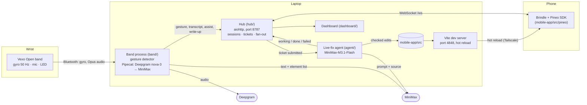

# Pineo

**Review an app with your wrist and your voice. Rotate your wrist, point at what is wrong, say it, and the app's source is changed while you hold the phone.**

You hold a phone running the web app you are reviewing and wear a [Vexo Open band](https://github.com/VexoAI-Org/vexo-open-kit) on the same wrist. Two wrist rotations start a debugging session and turn on the band's microphone. Ask "where can I block the card?" and the app navigates, scrolls and pulses the element. Rotate once to open a ticket, tap or circle the elements you mean, and say what is wrong or what to change. MiniMax writes the ticket up as a bug or an improvement, and a coding agent on MiniMax edits the app's source, so the change shows on the phone by hot reload a few seconds later. "Turn it back" undoes it. A dashboard shows the session, gestures, transcript, tickets and the agent's progress live.

**Demo video (1 min):** https://youtu.be/xUPbhJd4EEI

Built at VexoHacks, 14 November 2026. The app under review in this repo is "Brindle", a fictional mobile bank made for the demo.

## How it works in 30 seconds

| You do | What happens |
|---|---|
| Rotate the wrist twice | A session starts. The band's microphone turns on. The phone shows a small "Session" indicator and stays fully usable. |
| Ask "where is…", "how do I…", "show me…" | The app switches screen if needed, scrolls to the element and pulses a marker next to it, with a one-line answer. |
| Rotate once | A ticket opens. The phone enters selector mode: a tap or a long press selects an element, drawing a loop selects everything inside it. The tab bar still switches screens. |
| Say what is wrong or what to change | Live captions on the phone; the words and the selected elements go into the ticket. |
| Say "next issue", stop talking for 5 s, or rotate once | The ticket closes. "Next issue" also opens the next one. A ticket with no words and no selection is dropped. |
| Wait a few seconds | The phone shows "Working on it…", then "Done: …", and the change appears by hot reload. |
| Open a ticket and say "turn it back" | The last change is undone (no model call). |
| Rotate twice | The session ends and the microphone turns off. |

## Architecture



**Band process** (`band/pineo_band/`). Connects to the band through the organisers' kit library (`bandlink.py`), reads the gyro and runs the rotation detector (`gesture.py`, parameters in `band/gesture.json`), and sends raw `double` / `single` gestures to the hub. During a session it decodes the band's Opus audio to 16 kHz PCM and feeds a Pipecat pipeline (`voice.py`): `BandMicInput → DeepgramSTTService (nova-3) → UtteranceRouter → OpenAILLMService (MiniMax, function calling) → AnswerSink`. A question becomes an `assist` message naming one element id; a submitted ticket gets a write-up (`bug.enrich`: bug or improvement, title, summary, severity) from a second small pipeline so questions and write-ups do not wait for each other. Prompts and tool schemas are in `brain.py`. The spoken "next issue" is recognised here and sent as a `next` gesture.

**Hub** (`hub/server.py`). One aiohttp process on port 8787 and the single source of truth. Clients connect to `/ws?role=app|dashboard|band|agent`. It applies the gesture table (session start/end, ticket open/submit), holds a closing ticket open until the person has stopped speaking, drops empty tickets, attaches late words to the ticket they belong to, closes idle tickets, and stores tickets in `hub/data/` (git-ignored). It also serves the dashboard at `/dashboard/`, the built app at `/` as a fallback, the element list at `/api/kb`, and debug routes under `/api/debug/*`. The message contract is `docs/CONTRACT.md` (the "v3" sections are current).

**Phone client, the "Pineo SDK"** (`mobile-app/src/pineo/`). Everything Pineo adds to the reviewed app is in this one folder: the WebSocket client and state (`client.ts`), circle drawing and hit-testing (`circle.ts`), the overlay UI (`Overlay.tsx`, `pineo.css`) and the knowledge base (`elements.json`). The app marks each interactive element with `data-pineo-id="<id>"`; `elements.json` lists the same ids with a label, description, how-to and keywords (102 entries for Brindle), and it is the only thing the model knows about the app. `mobile-app/scripts/kb-check.mjs` fails the build if the markup and the file disagree. There is no screen recording: the app reports taps, long presses and drawn loops as element ids.

**Live-fix agent** (`agent/hub-runner.mjs`). Receives each submitted ticket from the hub. Without a model it locates the selected elements in the source (grep for the id), then makes one direct call to MiniMax asking for search/replace edits. Edits are applied in a private copy of the app, checked (`tsc --noEmit`, the id check, balanced CSS, nothing under `src/pineo/` touched) and only then copied into `mobile-app/src`, where Vite hot-reloads them. If the direct call gives nothing usable, the same prompt goes to a headless `claude` CLI session pointed at MiniMax's Anthropic-compatible endpoint. The runner keeps the before/after content of its last ten changes, so "undo" and "turn it back" restore files without a model call. Details and timings: `agent/README.md`.

**Dashboard** (`dashboard/`, static, served by the hub at `/dashboard/`). Shows the current session, each gesture and what it did, the live transcript, tickets with the selected elements and drawn loops, the write-up, and the agent's state per ticket. Press `D` for the debug panel, which drives everything without the band.

## How the hardware is used

- **Gyro, for gestures.** The band streams the gyro at 50 samples a second (gyro only; `PINEO_MOTION_RATE` or `--motion-rate` changes it). The detector looks for wrist rotations on the X axis. It was calibrated on recordings of the owner's own wrist made with `gesture/record.py`: a double rotation is four alternating lobes in about 0.9 s. A lobe counts above 350 °/s; a single rotation must peak above 700 °/s, so ordinary hand movement does not open tickets. The gyro runs all the time so a double rotation can start a session.
- **Microphone, only during a session.** The audio stream is switched on at session start and off at session end. Audio travels over Bluetooth as Opus, is decoded on the laptop and sent to Deepgram. Outside a session nothing is sent.
- **LED.** The band shows its own solid blue light while the microphone is on. At session end Pineo blinks it green once, then turns it off (`bandlink.py`).
- Bluetooth is the default link; `--usb` uses the cable.

## Sponsor technology and where it is used

| Technology | Used for | Where |
|---|---|---|
| Vexo Open band and kit | Gyro stream, microphone stream, LED, Opus decoding (`vexo_open` library, loaded from `vexo-open-kit/python`) | `band/pineo_band/bandlink.py`, `band/pineo_band/gesture.py`, `band/gesture.json`, `gesture/record.py` |
| Pipecat (`pipecat-ai` 1.16) | The voice pipeline: custom band-audio input, STT, routing, LLM with function calling | `band/pineo_band/voice.py`, tool schemas in `band/pineo_band/brain.py` |
| Deepgram (nova-3) | Streaming speech-to-text with interim results, endpointing 100 ms, key terms taken from the element list | `band/pineo_band/voice.py` (`DeepgramSTTService`), settings in `band/pineo_band/config.py` and `cli.py` |
| MiniMax (`MiniMax-M3.1-Flash`) | (1) Answering "where is…" questions with an element id, (2) writing up tickets, (3) the coding agent | (1, 2) `band/pineo_band/voice.py` and `brain.py` through the OpenAI-compatible API; (3) `agent/hub-runner.mjs` and `agent/lib/common.mjs` through the Anthropic-compatible API |

## Setup

Needs: macOS (developed on it; Bluetooth through `bleak`), Python 3.12, Node 20 or later, pnpm, a Vexo Open band, a Deepgram key and a MiniMax key. The agent's fallback path also needs the `claude` CLI on the PATH; the fast path does not.

```sh
# 1. Keys
cp .env.example .env          # then fill it in; .env is git-ignored

# 2. The organisers' kit (git-ignored here; or set PINEO_KIT_DIR to an existing clone)
git clone https://github.com/VexoAI-Org/vexo-open-kit

# 3. Python: one venv for the hub and the band process
python3 -m venv .venv
.venv/bin/pip install -r hub/requirements.txt
.venv/bin/pip install -r band/requirements.txt

# 4. The app
cd mobile-app && pnpm install && cd ..
```

Values in `.env` (names from `.env.example`):

| Name | What |
|---|---|
| `DEEPGRAM_API_KEY` | Deepgram key |
| `MINIMAX_API_KEY` | MiniMax key from platform.minimax.io |
| `MINIMAX_BASE_URL` | OpenAI-compatible endpoint; default filled in |
| `MINIMAX_ANTHROPIC_BASE_URL` | Anthropic-compatible endpoint for the agent; default filled in |
| `MINIMAX_MODEL` | `MiniMax-M3.1-Flash` |
| `PINEO_BAND_NUMBER` | The number on your band's bag; never guessed |
| `PINEO_DG_ENDPOINTING`, `PINEO_DG_KEYTERMS` | Optional Deepgram tuning |

`agent/` and `dashboard/` have no dependencies to install. `band/requirements.txt` pins the versions of the working environment (`pipecat-ai` 1.16.0 with the Deepgram and OpenAI extras, `bleak`, `pyserial`, `av`, `sounddevice`). The kit's `vexo_open` library is not on PyPI; the band process loads it from the clone in step 2.

## Run

Four processes, each in its own terminal, from the repo root. Order does not matter; each reconnects by itself.

```sh
hub/run.sh                                        # 1. hub on :8787 (prints the dashboard and phone URLs)
cd mobile-app && pnpm dev                         # 2. the app's dev server on :4848 (proxies /ws, /api, /dashboard to the hub)
PYTHONPATH=band .venv/bin/python -m pineo_band    # 3. band process over Bluetooth (add --usb for the cable)
agent/run-hub.sh                                  # 4. live-fix agent
```

Then open:

- Dashboard on the laptop: `http://localhost:8787/dashboard/`
- App on the phone: `https://<machine>.<tailnet>.ts.net:8443/` (see below)

**Phone and network.** The phone must load the app from the Vite dev server (port 4848), not from the hub, because the live change arrives by hot reload. Phone and laptop are on the same Tailscale network. On our laptop the macOS firewall blocked incoming connections to node, so the dev server is published to the tailnet only, over HTTPS, with Tailscale itself:

```sh
tailscale serve --bg --https=8443 http://127.0.0.1:4848    # start
tailscale serve --https=8443 off                           # remove
```

The phone then opens `https://<machine>.<tailnet>.ts.net:8443/`. This is the setup we ran and verified: Vite's hot-reload socket and Pineo's `/ws?role=app` socket both connect as `wss://` through it, and edits apply on the phone without a page reload. Vite only answers host names it allows; `mobile-app/vite.config.ts` allows `*.ts.net` and `localhost`. If your firewall lets node accept connections, `http://<laptop>:4848/` works too (add a bare IP to `server.allowedHosts`).

**Before a demo.** `agent/reset-app.sh snapshot` records the current `mobile-app/src` as the clean state; `agent/reset-app.sh restore` puts it back between runs.

### Without the band

Everything can be driven from the dashboard: open `http://localhost:8787/dashboard/` and press `D`.

- **Double / Single / Next** send the same gestures the band sends.
- **Tap / Circle** add a selection to the open ticket.
- The transcript box sends an interim or a final line as if it were spoken.
- **Assist** highlights an element id on the phone.
- **Run scripted ticket**, **Write up**, **Simulate fix**, **Toggle band** and **Reset all** do what they say.

The same routes are plain HTTP (`POST /api/debug/gesture {"name":"double"}`, `/api/debug/transcript {"text":"…","final":true}`; full list in `docs/CONTRACT.md`). The band process also runs without a band. Typed words skip Deepgram and go through the rest of the pipeline to MiniMax:

```sh
PYTHONPATH=band .venv/bin/python -m pineo_band --no-band --say "where can I block my card?"
PYTHONPATH=band .venv/bin/python -m pineo_band --no-band --laptop-mic      # the laptop's microphone instead of the band's
```

The phone has its own small debug panel: open the app with `?debug=1`, or triple-tap the header.

### Tests

```sh
(cd hub  && ../.venv/bin/python -m pytest)   # hub (no band, no keys)
(cd band && ../.venv/bin/python -m pytest)   # band process (no band, no keys)
node agent/test/review-e2e.mjs             # agent safety checks, no model
cd mobile-app && pnpm build                # id check + typecheck + build
```

## What is real, and what is not

Measured in the owner's session on 14 November 2026, from the live logs, on the real band, a real phone over Tailscale and the real services (single runs unless stated; the last row is from the agent's own tests):

| What | Result |
|---|---|
| "Make numbers green on the balance" (ticket closed → change on the phone) | 3.2 s |
| "Make them black as it was before" (undo) | 1.9 s |
| A harder request with nothing selected | 12.3 s |
| "Where can I block the card?" → element highlighted | about 2.1 s |
| Deepgram final transcript after the end of speech (endpointing 100 ms) | typically 60–180 ms |
| Agent on its own (no band, test hub): a text or colour change on one element | usually 2–3.5 s; worst of 20 runs 11.4 s |

Known limits:

- **One app.** Pineo works on Brindle because Brindle carries `data-pineo-id` attributes and a hand-written `elements.json`. Another app needs the same two things.
- **One wrist.** The gesture thresholds come from one person's recordings. Other wrists were not tested.
- **"Done" means it compiles, not that it is right.** The agent checks types and ids. A valid but wrong edit, or an edit to the wrong element, still reports done. Undo is the remedy.
- **The agent only changes what it is told to.** A bug report with no stated fix ("the total is wrong") is written up as a ticket but not fixed.
- **Slow tail.** MiniMax occasionally takes 10–30 s for a call that normally takes 2 s. The agent sends a second and third identical call after 3 s and 6 s and takes the first answer.
- **Stale labels.** The agent never edits `elements.json`, so after a text change the label there is out of date (ids stay correct).
- **No access control.** The hub listens on all interfaces with no login, and the debug routes include "erase all tickets". Run it on a private network only.
- **No spoken answers.** Answers are shown on the phone, not spoken.
- **Tickets closing by themselves when the description sounds complete** exists (`PINEO_AI_CLOSE=1`) but is off; "next issue", the 5 s pause and the single rotation are what we use.
- The independent reviews in `docs/reviews/` list more risks; some were fixed afterwards (see "Changes after the review" in `agent/README.md`), not all were re-tested.

## Repo layout

```
band/         band process: kit link, gesture detector, Pipecat voice pipeline (Python)
hub/          hub: WebSocket + HTTP, sessions and tickets (Python, aiohttp)
agent/        live-fix agent (Node, no dependencies); hub-runner.mjs is the current one
mobile-app/   Brindle, the reviewed app (React + Vite + TypeScript)
  src/pineo/  the Pineo SDK: client, circle drawing, overlay, elements.json
dashboard/    live dashboard and debug panel (static HTML/JS)
gesture/      record.py and analyze.py, used to calibrate the detector
docs/         CONTRACT.md (messages), ELEMENTS.md, MOBILE-DEMO-SCRIPT.md, DEVPOST.md, VIDEO-SCRIPT.md, reviews/, screenshots
.env.example  the environment variables
```

Not in this repo: `vexo-open-kit/` (the organisers' kit, cloned separately), `.env`, `hub/data/`.

## Credits and licences

- Pineo: MIT, see `LICENSE`.
- [Vexo Open kit](https://github.com/VexoAI-Org/vexo-open-kit) by Vexo AI, MIT. Used as a library, not copied into this repo.
- [Pipecat](https://github.com/pipecat-ai/pipecat), BSD 2-Clause.
- Deepgram and MiniMax are used through their APIs with the keys the hackathon provided.
- React, Vite, TypeScript, aiohttp, bleak, PyAV: see each project's licence.
- Brindle is fictional. Any resemblance to a real bank is accidental.
